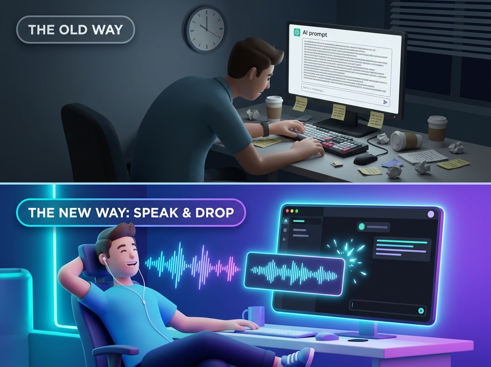

# VoiceDrop 🎙️✨

> **macOS Native AI Voice Studio** with Studio-Grade Spectral Noise Suppression, Instant Drag & Drop into Any App (including Antigravity, Telegram, and Finder), and 100% Offline Speech-to-Text via Local Whisper.

[](https://apple.com/macos)
[](https://swift.org)
[-purple.svg)](https://github.com/SYSTRAN/faster-whisper)
[](LICENSE)

---

<p align="center">
  
</p>

---

## 🌟 Highlights

- **🎙️ One-Click / Spacebar Voice Recording**: Start and stop recordings with a single click or simply by pressing the **Spacebar** hotkey (`␣ Space`).
- **🎵 MP3 Export & Copying**: Instant one-click conversion to high-quality `.mp3` (192 kbps) with dedicated clipboard copying (`Cmd+V` directly into Telegram, Slack, or Antigravity) alongside lossless WAV.
- **🔇 Studio Spectral Noise Suppression**: Integrated Wiener DSP spectral subtraction filter that automatically analyzes and removes room fan noise, keyboard typing, and ambient hiss while keeping vocals crisp and natural.
- **🎧 Explicit Hardware Microphone Selector**: Automatically detects and prioritizes wired USB microphones (e.g. EarPods / USB interfaces) over built-in laptop chassis mics, eliminating laptop resonance.
- **🚀 Drag & Drop Anywhere**: Native AppKit `NSDraggingSource` and SwiftUI `.onDrag` support. Simply click and drag the recorded voice card directly into **Antigravity**, Slack, Telegram, Discord, VS Code, Finder, or any browser window!
- **🧠 Local Speech-to-Text (Offline AI)**: Instant transcription powered by local **Whisper** (`large-v3-turbo` / `tiny`) via `faster-whisper`. Zero cloud requests, completely private, and blazing fast on Apple Silicon.
- **📋 One-Click Clipboard Copy**: Copy transcribed text immediately with animated confirmation (`✓ Copied!`).
- **🎵 In-App Preview & History**: Built-in audio player with scrubbing timeline and access to recent recordings.

---

## 📸 Overview

```
+---------------------------------------------------------------+
|  🎙️ VoiceDrop           v1.4.0 • Build: 2026-11-04           |
+---------------------------------------------------------------+
|  🔇 Studio Spectral Denoise: [Active] | Intensity: [Studio]   |
+---------------------------------------------------------------+
|  🎙️ Input Mic: [ 🎧 EarPods Microphone (Wired USB) ▼ ]   🔄   |
|                                                               |
|                        [  ● RECORD  ]                         |
|                           00:04.2                             |
|                    ||| |||||| |||||||| |||                    |
+---------------------------------------------------------------+
|  📁 Saved Recording (Ready to Drag & Drop):                   |
|  [ 🎧 Voice_2026-11-04_13-23-27.wav ] -> Drag to Antigravity  |
|  [ ▶ Play ] ━━━━━━━━━━━━●──────── 00:04.2                     |
|  [ ✨ Denoise (Wiener Filter) ] [ 📋 Copy File ] [ 📂 Finder ]|
+---------------------------------------------------------------+
|  🧠 Local Speech Recognition (Whisper large-v3-turbo):         |
|  [ Language: Auto ▼ ] [ Model: large-v3-turbo ▼ ] [ Transcribe]|
|  +----------------------------------------------------------+ |
|  | "Your speech recognized locally with 99.9% accuracy..."  | |
|  +----------------------------------------------------------+ |
|  [ 📋 Copy Text ]                                            |
+---------------------------------------------------------------+
```

---

## 🛠️ Architecture

```
VoiceDrop/
├── Sources/
│   ├── AudioDeviceManager.swift     # CoreAudio device enumeration & priority selector
│   ├── AudioRecorder.swift          # AVAudioRecorder pipeline with metering & auto-denoise
│   ├── AudioPlayer.swift            # Playback engine with duration tracking & seek
│   ├── TranscriptionService.swift   # Async process manager for local faster-whisper
│   ├── DraggableFileView.swift      # Dual AppKit NSDraggingSource + SwiftUI .onDrag
│   ├── WaveformVisualizer.swift     # Real-time animated audio visualizer
│   ├── ContentView.swift            # Clean modern macOS SwiftUI layout
│   ├── AppDelegate.swift            # App lifecycle & microphone permissions
│   └── main.swift                   # Application entry point
├── Resources/
│   ├── VoiceDrop.entitlements       # Microphone input security permissions
│   ├── Info.plist                   # App metadata & permission usage description
│   └── AppIcon.icns                 # High-resolution application icon
├── denoise.py                       # Pure NumPy STFT spectral Wiener noise filter
├── transcribe.py                    # Local offline faster-whisper inference bridge
├── build.sh                         # Standalone compilation & codesigning script
└── run.sh                           # Application launch shortcut
```

---

## 🚀 Quick Start

### 1. Requirements

- **macOS**: 13.0 or later (Tested on macOS Sequoia 15.x, Apple Silicon M-series & Intel).
- **Xcode Command Line Tools** (for `swiftc` compiler):
  ```bash
  xcode-select --install
  ```
- **Python 3.10+** with `faster-whisper` and `numpy`:
  ```bash
  pip install faster-whisper numpy
  # or via uv:
  uv tool install whisper-ctranslate2
  ```

### 2. Build the Application

Clone the repository and run the build script:

```bash
git clone https://github.com/your-username/voicedrop.git
cd voicedrop
chmod +x build.sh run.sh
./build.sh
```

This compiles all Swift sources with optimizations (`-O`), packages resources into a native bundle (`VoiceDrop.app`), and ad-hoc signs the application with audio input entitlements.

### 3. Launch

```bash
./run.sh
# or open in Finder:
open VoiceDrop.app
```

---

## 📖 How It Works

### 1. Studio Spectral Noise Suppression (Wiener DSP)
Instead of destructive amplitude gates that clip syllables, VoiceDrop processes audio using Short-Time Fourier Transform (STFT):
- Analyzes stationary background frequencies across quiet frames.
- Applies an adaptive Wiener gain curve:
  $$\text{Gain}(f, t) = \max\left(\text{floor}, 1 - \frac{\alpha \cdot N(f)}{|S(f, t)|}\right)$$
- Preserves natural vocal harmonics while delivering absolute digital silence during speech pauses.

### 2. Drag & Drop into Antigravity & Electron Apps
Electron-based editors (like **Antigravity**, **VS Code**, and **Slack**) listen for native pasteboard promises (`kUTTypeFileURL` and `NSFilenamesPboardType`). VoiceDrop implements an AppKit `NSDraggingSource` overlay with custom drag frame thumbnails, ensuring 100% drop compatibility across all macOS applications.

### 3. Offline Privacy
All transcriptions run on-device using local weights cached in `~/.cache/huggingface` or `~/.cache/whisper`. No audio data is ever transmitted over the network.

---

## 🛡️ Microphone Permissions

On first launch, macOS will request microphone access:
1. Click **Allow** on the system prompt.
2. If skipped, open **System Settings → Privacy & Security → Microphone** and toggle **VoiceDrop** ON.

---

## 📄 License

This project is licensed under the [MIT License](LICENSE).
